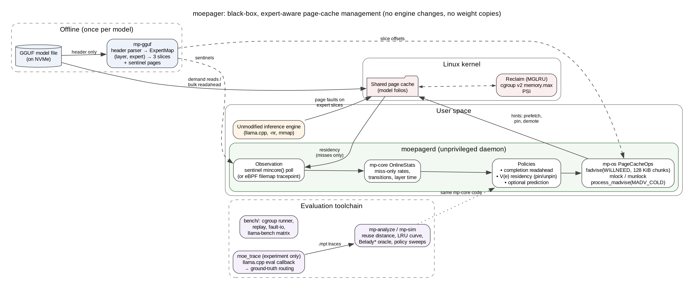

# Component 1 — Title, Abstract and Architecture

## 1.1 Project title

**Formal title:** System and Method for Non-Invasive, Expert-Aware Page-Cache
Management for Mixture-of-Experts Model Inference on Memory-Constrained
Linux Hosts

**Working title:** `moepager`: expert-aware page-cache management for
running Mixture-of-Experts LLMs on low-RAM Linux machines, without
modifying the inference engine.

**Repository:** https://github.com/shreshth006/moepager (team fork with
additional documentation: https://github.com/AyushSinha2210/moepager,
branch `ayush`)

## 1.2 Abstract

Mixture-of-Experts (MoE) language models such as Qwen3-30B-A3B,
gpt-oss-20b and OLMoE-1B-7B activate only a few experts per layer for each
token: 4 of 32 in gpt-oss-20b, 8 of 64 in OLMoE, 8 of 128 in Qwen3. That
sparsity makes them attractive on consumer machines. When the model file is
larger than free RAM, an engine such as llama.cpp maps it with `mmap`, and
the Linux page cache decides which weights stay in memory. The kernel's
generic policies, however, know nothing about the model's structure.

Reading the real GGUF headers of these three models shows two facts the
kernel cannot see:
- Expert tensors make up 84–95 % of each file.
- One expert at one layer is stored as three slices in three different
  tensors (`ffn_up_exps`, `ffn_gate_exps`, `ffn_down_exps`), about 110–410
  MB apart in the Qwen3 file.

We also found that llama.cpp's default CPU weight "repacking" moves most
expert weights into anonymous memory on AVX2 machines: 77 % of Qwen3's
expert bytes. Page-cache management therefore requires running llama.cpp
with `--no-repack`.

We present **moepager**, an unprivileged user-space daemon and toolchain
that manages the shared page cache at the granularity of (layer, expert)
units, treating the inference engine as a black box. It works as follows:
1. It parses the GGUF header into an *expert map*.
2. It detects expert use from page-cache misses, by polling one sentinel
   page per slice with `mincore()` (or, with root, a filemap eBPF
   tracepoint).
3. It reacts with *expert-completion readahead*: as soon as one slice of an
   expert misses, it reads the rest of that expert in bulk with
   `posix_fadvise(WILLNEED)` in 128 KiB chunks. The chunking is needed
   because we found the kernel silently truncates each WILLNEED to the
   device's readahead size.
4. A value-per-byte residency policy, V(e), estimated only from observed
   misses, can additionally pin hot experts (`mlock`) and demote cold ones
   (`process_madvise(MADV_COLD)`).

The policy code is shared with a trace-driven simulator that includes a
Belady oracle. The simulator's LRU agrees exactly with an independently
computed LRU miss-ratio curve.

In a microbenchmark on our development laptop (NVMe SSD, btrfs), we read
cold Qwen3-sized expert units through mmap page faults. They arrived at
0.41–0.52 GB/s, with 3.3–3.7× read amplification caused by the
filesystem's 4 MiB read-around. Bulk chunked WILLNEED of the same slices
reached 2.37–2.46 GB/s with no amplification, roughly 5× faster.
**End-to-end results with llama.cpp are reported in Component 3: [TO FILL
FROM PHASE 7].**

## 1.3 System architecture

The figure is `docs/report/architecture.png`, generated from
`architecture.dot`; SVG and PDF versions sit alongside it.

- **Offline (once per model):** `mp-gguf` reads only the GGUF header and
  builds the expert map. Each (layer, expert) unit gets its three slice
  offsets and sentinel pages.
- **Runtime:**
  - The unmodified engine (llama.cpp with `-nr`) faults expert slices into
    the shared page cache.
  - `moepagerd` observes misses (sentinel `mincore` polling, unprivileged),
    updates `mp-core` statistics, and issues page-cache hints through
    `mp-os`:
    - chunked WILLNEED for completion readahead;
    - `mlock` for pinning (needs `CAP_IPC_LOCK`);
    - `MADV_COLD` for demotion (needs `CAP_SYS_NICE`).
  - No weights are copied; the engine and the daemon share the same page
    cache folios.
  - For fair accounting, both run inside one cgroup v2 scope with a
    `memory.max` budget.
- **Evaluation:**
  - `moe_trace`, an experiment-only llama.cpp eval callback, records
    ground-truth routing.
  - `mp-analyze` and `mp-sim` compute reuse distances and run policy sweeps
    against the Belady oracle, using the same `mp-core` code as the
    daemon.
  - `bench/` runs real-kernel replays, the bandwidth microbenchmark and
    llama-bench under memory limits.

---

## Corrections to the earlier draft (and why)

| Draft said | Problem | Now |
|---|---|---|
| "Empirical validation demonstrates that moepager completely eliminates read amplification … 2.42 GB/s (5.3×) … confirming that page caches can serve as zero-copy MoE tiers" | Those numbers come from the `fault-io` **microbenchmark** of the readahead *mechanism* on a synthetic file. moepager had not been run with llama.cpp. Claiming end-to-end validation would be false. | Stated as a microbenchmark result; end-to-end numbers come from Phase 7 |
| "Uncoordinated demand faults trigger read-around (up to 4 MiB)" as a general fact | 4 MiB is the **btrfs** readahead window on our laptop. A typical ext4/NVMe setup uses 128 KiB. | Attributed to btrfs on the test machine |
| "block-device-aligned 128 KiB chunks" | The chunks avoid the kernel's **silent truncation** of a single WILLNEED to `max(io_pages, ra_pages)`; alignment is not the point. | Reason stated correctly |
| "catastrophic performance collapse" | Not measured. | Removed |
| "Existing optimization methods require invasive forks" | Most are in-engine patches or open PRs (llama.cpp #25294, #26824, …). They change the engine, but "forks" overstates it. | "require modifying the engine" |
| `mlock` / `MADV_COLD` presented as working parts | Implemented but **untested on real hardware**: pinning needs `CAP_IPC_LOCK` beyond the 8 MB default limit, and demotion needs `CAP_SYS_NICE`. | Marked as optional, privilege-dependent |
| "exposure-compensated marginal utility estimator" | Fine, but it should say what it is: the miss rate per token while unpinned, with pinned units frozen. | Explained |
| Title "Virtual Memory Page-Cache Orchestration" | Acceptable. "Page-cache management" is more precise, since moepager hints the page cache and doesn't manage virtual memory mappings. | Adjusted |
