# moepager

## Expert-Aware Page-Cache Management for Mixture-of-Experts LLM Inference on Memory-Constrained Linux Machines

**Formal title:** System and Method for Non-Invasive, Expert-Aware
Page-Cache Management for Mixture-of-Experts Model Inference on
Memory-Constrained Linux Hosts

**Repository:** https://github.com/shreshth006/moepager · team fork:
https://github.com/AyushSinha2210/moepager (branch `ayush`)

# 1. Title, Abstract and Architecture

## 1.1 Abstract

Mixture-of-Experts (MoE) language models activate only a few "expert"
sub-networks per layer for each token: 8 of 64 in OLMoE-1B-7B, 4 of 32 in
gpt-oss-20b, 8 of 128 in Qwen3-30B-A3B. That makes them attractive for
consumer machines, which run them with llama.cpp in `mmap` mode when the
model is larger than free RAM, leaving the Linux page cache to decide
which weights stay in memory.

We show that the kernel's generic behaviour fits this workload poorly:
- **Scattered units.** One expert's weights are three slices in three
    tensors hundreds of megabytes apart.
- **Read-around pollution.** On a page fault, the kernel reads a window
    around the faulting page: 4 MiB on our test machine's btrfs. That pulls
    unused neighbouring experts into the cache and multiplies SSD traffic
    3.7–4.8×.
- **Repacking.** llama.cpp's default CPU weight repacking moves 77–100 % of
    expert bytes into anonymous memory, outside the page cache.

We present **moepager**, a Rust toolchain and an unprivileged user-space
daemon that manage the shared page cache at the granularity of
(layer, expert) units, without changing the inference engine's code or
binary:
1. It parses the GGUF header into an exact expert map.
2. It observes expert misses black-box by polling sentinel pages with
      `mincore()`.
3. It answers each miss with **expert-completion readahead**: bulk
      `posix_fadvise(WILLNEED)` of the expert's remaining slices in 128 KiB
      chunks. The chunking is necessary because the kernel silently truncates
      larger requests.
4. A 64-line `LD_PRELOAD` shim turns off fault read-around on the model
      mapping, which no stock llama.cpp option does on single-node machines.

The evaluation toolchain records ground-truth routing from llama.cpp,
computes exact LRU miss-ratio curves, simulates policies against a Belady
optimum, and runs llama.cpp under cgroup memory limits.

On a 15 GB laptop running OLMoE-1B-7B (4.2 GB) under memory limits of
1.5 GB and 2.5 GB, moepager's configuration decoded **1.40 and 3.21
tokens/s**, versus 0.35 and 0.87 tokens/s for the same engine served by
the default page cache. That is **3.7–4.0× faster**, with **7–8× less SSD
traffic** and memory-pressure stall reduced from 12.7 % to 1.0 %. Default
llama.cpp, by contrast, was OOM-killed at both limits unless allowed to
spill 2.3–2.5 GB into compressed RAM swap.

We also report what did not work: a value-based pinning policy captured
little of the optimal policy's 34–74 % miss reduction, and completion
readahead without turning off read-around made performance worse.

## 1.2 System architecture

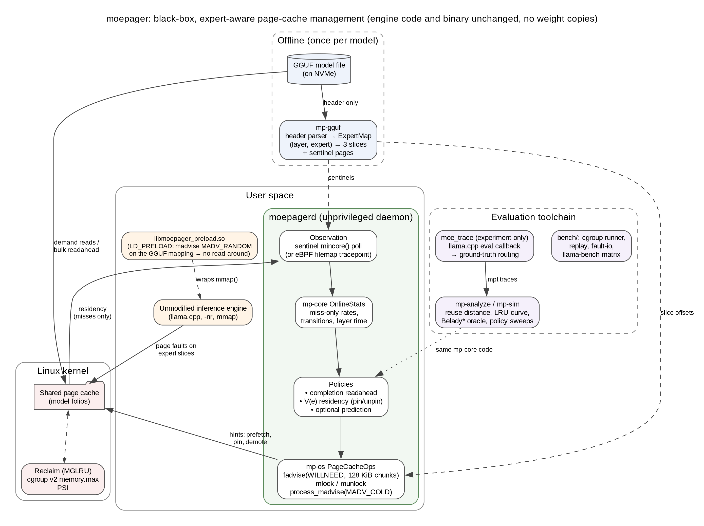

*Figure 1. moepager architecture (source: `docs/report/architecture-portrait.dot`; a landscape version is `architecture.png`).*

- **Offline, once per model:** `mp-gguf` reads only the GGUF header and
    builds the expert map: each (layer, expert) unit's three slice offsets
    and sentinel pages.
- **Runtime:**
    - The unmodified engine runs with `--no-repack` (so weights stay in the
        page cache) and with the `LD_PRELOAD` shim, which turns off read-around
        on the model mapping.
    - Its page faults bring expert slices into the shared page cache.
    - `moepagerd` polls sentinel pages, so it sees misses only. It updates
        `mp-core` statistics and issues page-cache hints through `mp-os`:
        - chunked WILLNEED for completion readahead (no privilege needed);
        - optional `mlock` pinning (`CAP_IPC_LOCK`);
        - optional `MADV_COLD` demotion (`CAP_SYS_NICE`).
    - No weights are copied: engine and daemon share the same page-cache
        pages.
    - Both run inside one cgroup v2 scope with a `memory.max` budget, so
        every page is charged to the same budget.
- **Evaluation:**
    - `moe_trace`, an experiment-only llama.cpp eval callback, records
        ground-truth routing.
    - `mp-analyze` and `mp-sim` evaluate policies against Belady\*, using
        the same `mp-core` code as the daemon.
    - `bench/` runs real-kernel replays, the bandwidth microbenchmark and
        llama-bench under memory limits.

# 2. Introduction and Problem Statement

## 2.1 Background

Mixture-of-Experts (MoE) language models replace each dense feed-forward
block with many smaller "expert" networks plus a router. For every token,
the router picks a few experts per layer (top-k), so only a small fraction
of the parameters is used per token. In the three models studied here
(values read from the real model file headers):

| Model | File (quantisation) | Size | Layers × experts | top-k | Expert share of file |
|---|---|---|---|---|---|
| OLMoE-1B-7B-0924 | Q4_K_M | 4.21 GB | 16 × 64 | 8 | 92.6 % |
| gpt-oss-20b | MXFP4 | 12.11 GB | 24 × 32 | 4 | 84.1 % |
| Qwen3-30B-A3B | Q4_K_M | 18.56 GB | 48 × 128 | 8 | 94.6 % |

Because only 4–8 experts per layer are touched per token, MoE models are an
attractive fit for consumer machines. A common way to run a model larger
than free RAM is llama.cpp in `mmap` mode: the model file is mapped into
memory, and the Linux page cache loads weights on demand and evicts them
under memory pressure.

## 2.2 Problem statement

The kernel's page cache is generic. Its reclaim policy (MGLRU) and its
fault read-around know nothing about how a GGUF file is laid out or how MoE
routing behaves. Our measurements on a 15 GB laptop (Section 6) show three
concrete problems:

1. **The unit of use is scattered.** One expert at one layer is stored as
      three slices in three different tensors (`ffn_up_exps`, `ffn_gate_exps`,
      `ffn_down_exps`), hundreds of megabytes apart. The kernel cannot know
      these three ranges belong together.
2. **Read-around pollutes the cache.** On a page fault, Linux reads a window
      around the faulting page: 4 MiB on this machine's btrfs filesystem. For
      expert slices of about 1–1.3 MB, most of that window belongs to
      neighbouring experts that will not be used. Replaying real OLMoE routing
      under a 1.5 GB budget, the SSD read **1.80 GB per token to deliver
      0.49 GB of needed expert weights** (3.7× amplification), and almost
      every expert access missed.
3. **Fault-driven reads are slow.** Faulting cold experts in through mmap
      delivered only 0.15–0.24 GB/s on the real model file. Reading the same
      bytes with large prefetch requests delivered 1.5–1.7 GB/s.

A further, practical problem: llama.cpp on x86 CPUs with AVX2 by default
*repacks* the most common quantised expert weights into ordinary
(anonymous) memory. That is 77 % of the expert bytes for OLMoE and Qwen3
Q4_K_M, and 100 % for gpt-oss MXFP4. Under memory pressure those pages go
to swap instead of the page cache.

**Goal:** make MoE inference faster on memory-constrained Linux machines,
using knowledge of the model file's structure and of routing behaviour,
**without modifying the inference engine** and without copying the
weights.

# 3. Literature Review and Objectives

## 3.1 Related work

**MoE offloading inside the inference engine.** Most systems that keep
only part of an MoE model in fast memory are built into the engine, where
the router's decisions are directly visible:
- mixtral-offloading (Eliseev & Mazur, 2023): LRU expert cache plus
    speculative prefetch.
- MoE-Infinity (Xue et al., 2024): activation-aware expert cache.
- HOBBIT (2024): mixed-precision experts, implemented as about 8,000 lines
    added to llama.cpp.
- Pre-gated MoE, ProMoE, DuoServe-MoE, Fate and similar: predict
    next-layer experts and prefetch them.

Inside llama.cpp itself there are several open proposals: PR #25294
(O_DIRECT expert streaming that bypasses the page cache), PR #26824 (expert
heat map and mmap pinning), PR #29887, issue #20757 and discussion #27149.
All of these modify the engine.

**Using the OS page cache as the expert tier.** Si et al. (arXiv
2608.12103, 2026) is the closest study. On a datacenter GH200 node they
show that kernel recency (LRU) serves about as much demand as an oracle
static-frequency pin, that Belady's bound leaves about one third of LRU's
misses addressable, and that `fadvise(WILLNEED)` prefetch hints gained only
0.3–5 %. Their engine reads with `pread`, so mmap fault behaviour and file
structure play no role.

**Operating-system mechanisms.**
- cache_ext / cachebpf (Zussman et al., 2025) lets eBPF programs replace
    page-cache eviction, but needs a patched kernel.
- MGLRU and DAMON are generic and know nothing of model structure.
- vmtouch pins or evicts file ranges given by the user.
- "LLM in a flash" (Alizadeh et al., Apple, 2024) and PowerInfer-2 bundle
    co-used weights to make flash reads large. That is the same idea as our
    expert-completion readahead, but those systems implement it inside the
    engine and require reformatting the model.

**Gap.** We found no system that manages the page cache for an
*unmodified* engine using the *model file's structure*, and none that
measures the effect of mmap fault read-around on MoE experts.

## 3.2 Objectives

- **O1.** Build an exact map from GGUF files to (layer, expert) units and
    their byte and page ranges, verified on real models.
- **O2.** Observe expert usage from outside the engine, without root.
- **O3.** Build an evaluation toolchain: ground-truth routing traces, trace
    analysis, a policy simulator with an optimal (Belady) bound, real-kernel
    replay, and benchmarks under a fixed memory budget.
- **O4.** Implement page-cache actuators: chunked readahead, pinning and
    demotion. Combine them in a daemon whose policy code is identical to the
    simulated one.
- **O5.** Decide go/no-go on real hardware with predefined kill criteria,
    and report only measured numbers.

# 4. Methodology and Algorithms

## 4.1 Expert map (from the GGUF header)

A GGUF file starts with a header listing every tensor's name, shape, type
and offset. `mp-gguf` parses only this header, so a truncated prefix of a
file works too. For each tensor named `blk.<L>.<ffn_up|ffn_gate|ffn_down|ffn_gate_up>_exps.weight`
with shape `[ne0, ne1, n_expert]`:

- `bytes = type_size × ne0·ne1·n_expert / block_size`, using the ggml type
    table.
- Expert `e`'s slice is `[offset + e·bytes/n_expert, offset + (e+1)·bytes/n_expert)`.
    Each expert is contiguous inside a tensor because the expert index is the
    outermost dimension.
- 2-D per-expert tensors (`*_exps.bias`, `[ne0, n_expert]`) contribute one
    row per expert.

The slices of the same (L, e) are grouped into a **unit**, the granule for
everything that follows. Slices are 32-byte aligned rather than page
aligned, so a boundary page can belong to two units. A reverse page→unit
index (sorted intervals plus a prefix-maximum array) handles this in
O(log n).

For each slice, one **sentinel page** is chosen in its middle, at least
128 KiB from either edge, so that a neighbour's 128 KiB read-around cannot
trigger it.

## 4.2 Black-box observation

The daemon maps the model file read-only and periodically calls `mincore()`
on the sentinel pages. This works without root, even for files it doesn't
own. A sentinel changing from non-resident to resident means "unit
(L, e) has just been faulted in", which is a **miss**.

Hits are invisible to user space: pages already mapped are read through the
CPU's page tables with no kernel involvement. All online statistics are
therefore computed from misses only (Section 4.4).

Token boundaries are not visible either. They are inferred from layer
order: a new token starts when the observed layer drops below the running
maximum minus a slack. With root, the same events can be taken from the
`filemap:mm_filemap_add_to_page_cache` tracepoint (bpftrace script
included).

## 4.3 Expert-completion readahead (the main mechanism)

When a miss of unit u is observed, the daemon immediately issues
`posix_fadvise(WILLNEED)` over **all** slices of u, so the parts the engine
has not reached yet (typically the gate and down slices, hundreds of MB
away) arrive as large asynchronous reads instead of many small synchronous
faults. Two details turned out to be essential:

1. **Chunking.** The kernel silently truncates a single WILLNEED to
      `max(bdi->io_pages, ra->ra_pages)` pages (`force_page_cache_ra()` in
      `mm/readahead.c`). We found this when CI populated exactly 256 KiB of a
      1 MiB request. Requests are therefore issued in 128 KiB chunks.
2. **Refractory window.** Each unit has three sentinels, and the daemon's
      own prefetch flips the other two. Repeated misses of a unit within
      20 ms are ignored so that each real miss causes one prefetch.

The mechanism is prediction-free: it acts only on experts the router has
already chosen.

## 4.4 Residency policy V(e) (optional, privilege-dependent)

For pinning with `mlock`, each unit e of size s_e gets a value per byte:

        V(e) = rate(e) · (t_fault + s_e / B_demand) / s_e

Units are pinned greedily in decreasing V order until the pin budget is
used up. Hysteresis (a newcomer must beat a pinned unit by 25 %) limits
churn.

Because only misses are observable, rate(e) is defined as the **miss rate
per token while unpinned**: decayed miss count ÷ decayed number of tokens
the unit was exposed (not pinned). That is exactly the counterfactual a pin
decision needs. While a unit is pinned it produces no misses and no
exposure, so its estimate is frozen. A small random fraction of pinned
units is released at each re-plan ("exploration") to refresh stale
estimates. Exponential decay uses the scaled-weight trick, with periodic
renormalisation, for O(1) updates.

Demotion of cold units uses `process_madvise(pidfd, MADV_COLD)` on the
engine's mapping, because `fadvise(DONTNEED)` cannot evict pages another
process has mapped (verified experimentally).

## 4.5 Simulation and the optimal bound

`mp-sim` replays a routing trace against a byte-capacity cache:
- A hit costs nothing.
- A miss is queued on a FIFO I/O channel, costing `t_fault + s/B_demand`,
    or `s/B_bulk` when completion readahead is on.
- Compute time per layer is taken from the trace.

Policies: LRU, LFU, prefix pinning, an oracle static-frequency pin, V(e)
with full or miss-only observation, predictive prefetch, and **Belady\***
(evict the unit whose next use is furthest in the future). Belady\* is the
optimal bound for equal sizes and the standard heuristic for variable
sizes.

Independently, `mp-analyze` computes reuse distances with a Fenwick tree in
O(N log N) and derives the **exact LRU miss-ratio curve**. An access hits
in a byte-capacity LRU cache iff (bytes of distinct units since its last
use) + its own size ≤ capacity. The simulator's LRU agrees with this curve
exactly, a cross-check between two independent implementations.

## 4.6 Experimental method (go/no-go)

Kill criteria were fixed before measuring (IDEA_REVIEW §6):
- **K1:** Belady\* cannot save at least 15 % of misses relative to the
    kernel.
- **K2:** fault-driven bandwidth is at least 0.75× bulk bandwidth.
- **K3:** default llama.cpp beats every page-cache configuration.

Experiments:

- **A: routing.** Record real routing with `moe_trace`, a 170-line
    experiment-only tool that reads llama.cpp's `ffn_moe_topk-<layer>`
    tensors through the scheduler's eval callback. Three prompts (chat, code,
    prose) × 255 decode tokens on OLMoE, then analyze and simulate.
- **B: real-kernel replay.** Replay the prose trace on the real model file
    under a cgroup v2 memory wall (`systemd-run --user -p MemoryMax=…`,
    swap 0). Measure SSD bytes (`/proc/self/io`), major faults and time.
- **C: bandwidth microbenchmark.** Read cold expert-sized units of the real
    file through mmap faults, chunked WILLNEED, or pread.
- **D: end to end.** `llama-bench` decode throughput under the same memory
    walls, for:
    - B0: default llama.cpp;
    - B2: `--repack 0`;
    - D2: B2 + moepagerd;
    - P: B2 + read-around off;
    - PD: P + moepagerd.

    Daemon and engine always share the cgroup, so page-cache charges count
    against the same budget.

# 5. Implementation

## 5.1 Technology stack and structure

| Layer | Choice | Why |
|---|---|---|
| Core, simulator, daemon, CLI | **Rust** (stable), 10 crates, ≈ 8,900 lines | Predictable latency for a daemon; fast enough for simulation sweeps; one language, so the daemon and the simulator share the *same* policy code |
| OS interface | `libc` syscalls behind traits (`PageCacheOps`, `ResidencyProbe`) | Real Linux implementation + `MockOps` for deterministic tests |
| Ground-truth capture | C++ against `libllama` (`tools/moe_trace`, 169 lines) | Needs the engine's eval callback; experiment-only |
| Read-around shim | C, `LD_PRELOAD` (`tools/preload`, 64 lines) | Disables fault read-around on the model mapping without touching the engine's code or binary |
| Privileged tracing | bpftrace script (26 lines) | Optional, root only |
| Fixtures, metric parsing, probes | Python (stdlib + pytest), 674 lines | Independent GGUF writer so parser tests aren't self-confirming |
| Experiments | Bash + cgroup v2 (`systemd-run --user`), no root | Fixed memory budget per run |
| CI | GitHub Actions: fmt, clippy `-D warnings`, tests, ruff, pytest, demo smoke run | |

| Crate | Responsibility |
|---|---|
| `mp-gguf` | GGUF v2/v3 header parser, ggml type table, `ExpertMap`, page index, sentinels, repack-risk detection |
| `mp-trace` | `.mpt` binary trace format (spec in `docs/TRACE_FORMAT.md`), CSV import/export, token inference |
| `mp-core` | Deterministic RNG, cost model, `OnlineStats` (miss-only), `ResidencyEngine` (V(e)), `PrefetchPlanner` |
| `mp-synth` | Synthetic routing generator (skew, reuse, cross-layer affinity, drift) |
| `mp-analyze` | Fenwick-tree reuse distance, exact LRU miss-ratio curve, routing predictability, timing |
| `mp-sim` | Trace-driven cache + I/O-channel simulator, policies, Belady\* |
| `mp-os` | `mincore`, `cachestat`, chunked `fadvise`, `mlock`, `process_madvise`, `/proc/pid/maps`/`smaps` parsing |
| `mp-recorder` | Sentinel and full-scan recorders, page→expert conversion, bpftrace ingest, mmap/pread trace replayer |
| `moepager` | CLI: `gguf-map`, `synth`, `analyze`, `sim`, `import-csv`, `trace-csv`, `record`, `ingest-bpftrace`, `page2expert`, `replay`, `fault-io` |
| `moepagerd` | Daemon: policies `none`, `willneed-all`, `lru-pin`, `v`; sources `sentinel` / `trace:`; ops `linux` / `mock` |

## 5.2 Functional completeness

| Feature | Status |
|---|---|
| GGUF expert map, verified on 3 real models | done, tested |
| Ground-truth routing capture + import | done, used on OLMoE |
| Trace analysis, simulator, Belady bound | done, tested, used |
| Unprivileged sentinel observation | done, tested end to end on real files |
| Chunked completion readahead | done, measured (Section 6) |
| Read-around shim | done, measured (Section 6) |
| V(e) pinning | implemented and unit-tested; live use needs `CAP_IPC_LOCK` (default memlock limit is 8 MB), **not measured** |
| `MADV_COLD` demotion | implemented; needs `CAP_SYS_NICE`, **not measured** |
| eBPF observation | script + ingest written; needs root, **not run** |
| Start-up checks: read-around still on, daemon outside the engine's cgroup | done, tested live |
| `MADV_POPULATE_READ` prefetch fallback (`--prefetch-mode populate`) | done, tested on a real file; not benchmarked |
| PSI-driven budget control, dashboard | future work |

## 5.3 Correctness

- **Tests:** 87 Rust and 13 Python tests, run in CI. They include:
    - parser checks against GGUF files written by an *independent* Python
        writer;
    - an assertion that simulated LRU equals the analytically computed LRU
        curve exactly;
    - a check that Belady\* never loses to any other policy;
    - real-kernel tests of `mincore`/`cachestat`/`fadvise`/`mlock` semantics
        on a real file;
    - end-to-end recorder tests that recover a replayed trace with 100 %
        recall;
    - daemon dry runs.
- **Real-model checks:**
    - The map of OLMoE/Qwen3/gpt-oss matches tensor sizes in the headers.
    - Each captured (token, layer) has exactly top-k experts.
    - The no-read-around replay reproduced the simulator's LRU prediction
        (Section 6.3).
- **Bugs found by testing and fixed:**
    - WILLNEED truncation (found by CI);
    - the btrfs device-number mismatch between `stat()` and `/proc/pid/maps`;
    - read-around/compression spill causing false expert detections;
    - duplicate completion prefetches (refractory window).

## 5.4 Demonstration

`make demo` runs the full pipeline with no model or root. It parses the
real Qwen3 map, generates routing, analyzes it, simulates policies, does a
daemon dry run, and records a replayed trace black-box. With a model,
`bench/phase7.sh` runs experiments A–D. Terminal screenshots of the tools
on the real OLMoE model follow.

## 5.5 Screenshots (real output on OLMoE-1B-7B)

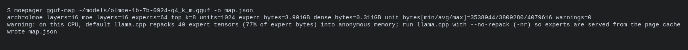
*Figure 2. Expert map from the real GGUF header, with the repack warning for this AVX2 CPU.*

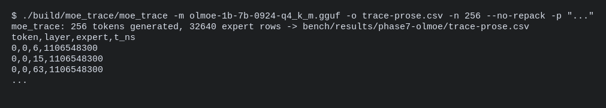
*Figure 3. Ground-truth routing capture through llama.cpp's eval callback.*

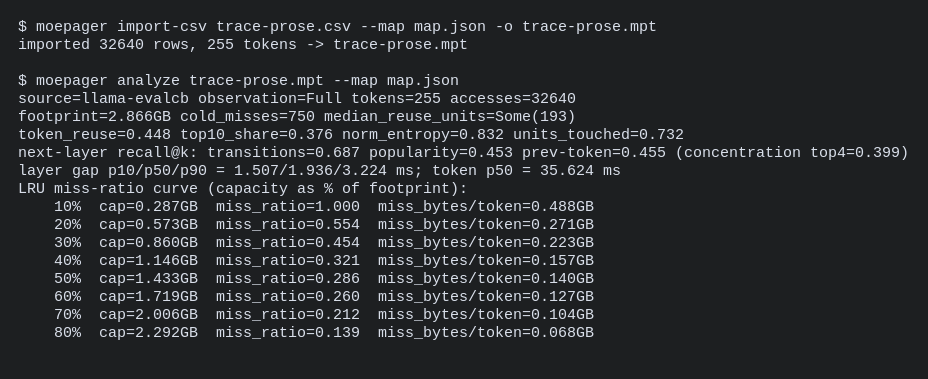
*Figure 4. Importing the routing trace and analyzing it: reuse, predictability, exact LRU curve.*

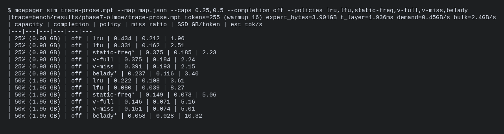
*Figure 5. Policy simulation, including the Belady\* bound.*

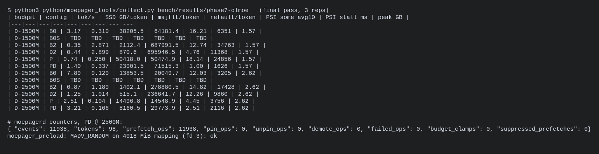
*Figure 6. Collected end-to-end results (B0S rows are OOM-killed runs), daemon counters, and the shim at work.*

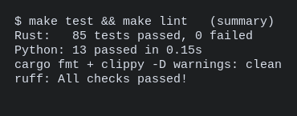
*Figure 7. Test and lint status.*

# 6. Results and Performance Evaluation

## 6.1 Setup

| Item | Value |
|---|---|
| Machine | Laptop, Intel i5-12450H (8 cores / 12 threads, AVX2), 15 GiB RAM + 8 GiB zram swap, desktop session running |
| Storage | Solidigm P41 Plus 512 GB NVMe (PCIe 4, QLC); `/home` is btrfs with `compress=zstd:1`; btrfs readahead window 4 MiB |
| OS | Fedora 42, Linux 6.19.14, MGLRU enabled |
| Engine | llama.cpp commit 970b51c (2026-10-22), CPU only, 8 threads |
| Model | OLMoE-1B-7B-0924 Q4_K_M (4.21 GB; 16 layers × 64 experts, top-8; experts 3.90 GB, units ≈ 3.8 MB) |
| Memory budget | cgroup v2 `memory.max` = 1.5 GB or 2.5 GB, swap off unless stated; daemon and engine in the same cgroup |
| Cold start | model evicted from the page cache before every run |

All numbers below are measured. Raw outputs are in
`bench/results/phase7-olmoe/` (logs, CSVs, cgroup statistics, journal
excerpts).

## 6.2 Experiment A: real routing, and how much any cache policy could gain

`moe_trace` recorded 255 decode tokens for each of three prompts: 32,640
expert uses per prompt. Measured properties:

| Prompt | Same expert reused on the next token | Top-10 % experts' share of uses | Next-layer recall: transitions / popularity / previous token |
|---|---|---|---|
| chat | 41 % | 30 % | 0.60 / 0.36 / 0.42 |
| code | 48 % | 55 % | 0.78 / 0.66 / 0.48 |
| prose | 45 % | 38 % | 0.69 / 0.45 / 0.46 |

Routing is strongly local in time (41–48 % reuse) and predictable across
layers (60–78 % recall). The simulator was fed these traces with expert
caches of 15–70 % of the expert bytes. Miss ratios for the prose prompt
(other prompts in the CSVs):

| Cache size | LRU | LFU | V(e), miss-only | Belady\* (optimal) | Belady\* saves vs LRU |
|---|---|---|---|---|---|
| 15 % | 0.552 | 0.500 | 0.672 | 0.345 | 38 % |
| 25 % | 0.434 | 0.331 | 0.391 | 0.237 | 45 % |
| 35 % | 0.291 | 0.205 | 0.274 | 0.144 | 50 % |
| 50 % | 0.222 | 0.080 | 0.151 | 0.058 | 74 % |
| 70 % | 0.004 | 0.004 | 0.004 | 0.004 | 4 % |

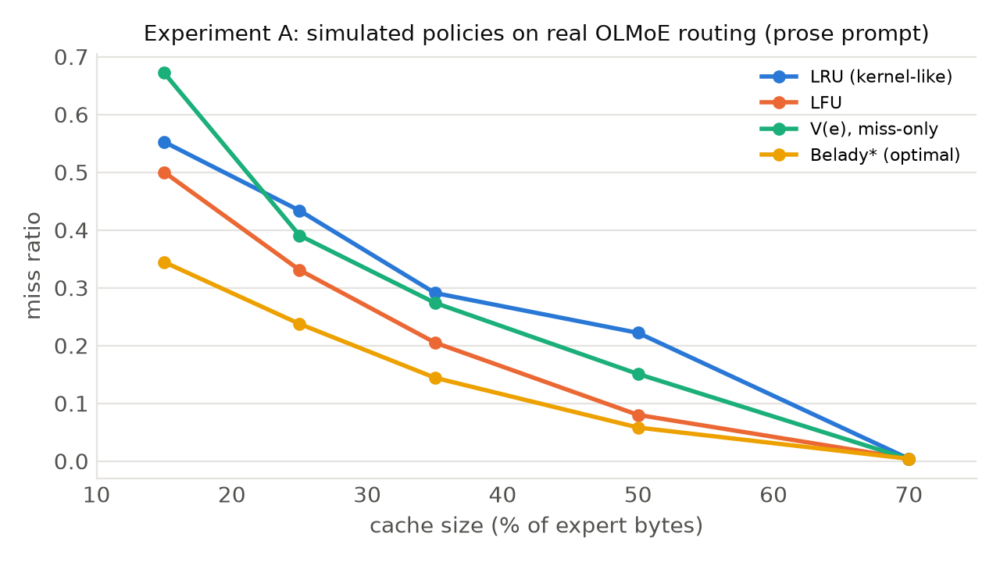

**Reading:**
- An optimal policy would avoid 34–74 % of LRU's misses at 15–50 %
    capacity across all three prompts, so kill criterion **K1 does not
    fire**.
- Our V(e) residency policy captures only part of that gap. It beats LRU
    at 25–50 % but is *worse* at 15 %.
- Plain LFU beats V(e) in most cells.

The residency policy is therefore the weakest part of the design. Since
pinning also needs `CAP_IPC_LOCK`, it was not used in the end-to-end runs.

## 6.3 Experiment B: what the real kernel does (and simulator validation)

The prose trace was replayed on the real model file through `mmap`, with 4
threads touching each expert's pages, under the memory wall. The trace
needs 0.49 GB of expert data per token.

| Budget | Variant | tokens/s | SSD read / token | Major faults / token |
|---|---|---|---|---|
| 1.5 GB | kernel default | 0.79 | **1.80 GB** | 956 |
| 1.5 GB | read-around off (`MADV_RANDOM`) | 0.75 | **0.16 GB** | 38,802 |
| 1.5 GB | + moepagerd (read-around on) | 0.66 | 1.61 GB | 881 |
| 1.5 GB | **read-around off + moepagerd** | **2.58** | 0.05 GB | 12,342 |
| 2.5 GB | kernel default | 3.25 | 0.37 GB | 338 |
| 2.5 GB | read-around off | **5.81** | 0.02 GB | 5,704 |
| 2.5 GB | + moepagerd (read-around on) | 2.82 | 0.36 GB | 321 |
| 2.5 GB | read-around off + moepagerd | 2.48 | 0.05 GB | 12,641 |

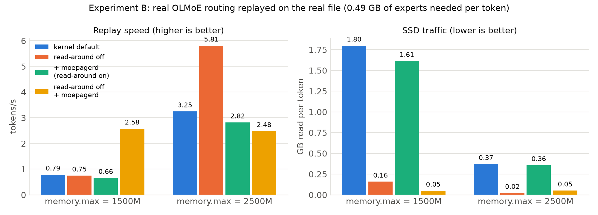

**Reading:**
- **Read-around pollution dominates.** With the kernel's default 4 MiB
    read-around, the SSD read 1.80 GB per token at 1.5 GB to deliver
    0.49 GB, and nearly every expert access missed: neighbouring, unused
    experts filled the cache.
- **The simulator is validated once pollution is removed.** With
    read-around off, traffic fell 11× to 0.16 GB/token, which matches the
    simulator's LRU prediction for this capacity (0.14 GB/token, Section
    6.2).
- **Fewer bytes alone is not faster.** Read-around off produced 39,000
    small 4 KiB faults per token, so speed stayed at 0.75 tok/s.
- **moepagerd needs read-around off.** With read-around on, its sentinels
    fire on polluted pages and it made things slightly worse. With
    read-around off it turns the small faults into bulk reads: **3.3×
    faster** than the kernel default at 1.5 GB.
- At 2.5 GB, where most accesses already hit, read-around off alone was
    best in this replay; the daemon added overhead.

## 6.4 Experiment C: fault-driven vs bulk read bandwidth

32 cold expert units (3.8 MB each, three slices) of the real model file
were read in three ways, 3 seeds each:

| Method | GB/s delivered | SSD bytes read ÷ needed |
|---|---|---|
| mmap page faults (8 threads) | 0.15–0.24 | 4.8× |
| WILLNEED, one call per slice | 0.97–1.42 | 1.00× |
| **WILLNEED, 128 KiB chunks** | **1.49–1.70** | **1.00×** |
| pread, 1 MiB blocks | 0.44–0.56 | 1.24× |

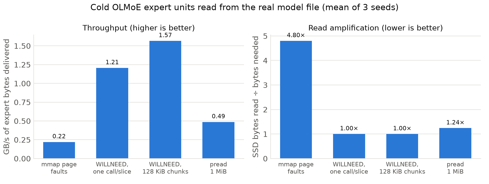

Bulk chunked readahead delivers expert bytes **≈ 7× faster** than page
faults, with no amplification, so kill criterion **K2 does not fire**.
Chunking matters: single calls are truncated by the kernel to the device
readahead size.

## 6.5 Experiment D: end to end with llama.cpp

`llama-bench` decoded 32 tokens × 3 repetitions (after a 1-token warmup)
inside the cgroup, starting cold. Decode throughput is mean ± standard
deviation over the 3 repetitions. SSD traffic and major faults are
cgroup/device totals divided by all 97 decoded tokens. PSI is the cgroup's
memory-pressure "some" average over the last 10 s at exit.

| Budget | Configuration | tokens/s | SSD GB / token | Major faults / token | Memory PSI (some, avg10) |
|---|---|---|---|---|---|
| 1.5 GB | B0 default llama.cpp (repack; zram swap allowed) | 3.17 ± 0.26 | 0.31 | 38,206 | 16.2 % |
| 1.5 GB | B0S default llama.cpp, no swap | **OOM-killed** | — | — | — |
| 1.5 GB | B2 `--repack 0` (page cache, kernel only) | 0.35 ± 0.01 | 2.87 | 2,112 | 12.7 % |
| 1.5 GB | D2 B2 + moepagerd | 0.44 ± 0.02 | 2.90 | 871 | 4.8 % |
| 1.5 GB | P B2 + read-around off (shim) | 0.74 ± 0.07 | 0.25 | 50,418 | 18.1 % |
| 1.5 GB | **PD B2 + read-around off + moepagerd** | **1.40 ± 0.22** | 0.34 | 23,902 | **1.0 %** |
| 2.5 GB | B0 default llama.cpp (repack; zram swap allowed) | 7.89 ± 1.37 | 0.13 | 13,854 | 12.0 % |
| 2.5 GB | B0S default llama.cpp, no swap | **OOM-killed** | — | — | — |
| 2.5 GB | B2 `--repack 0` | 0.87 ± 0.02 | 1.19 | 1,402 | 14.8 % |
| 2.5 GB | D2 B2 + moepagerd | 1.25 ± 0.04 | 1.01 | 515 | 12.3 % |
| 2.5 GB | P B2 + read-around off | 2.51 ± 0.51 | 0.10 | 14,497 | 4.5 % |
| 2.5 GB | **PD B2 + read-around off + moepagerd** | **3.21 ± 0.65** | 0.17 | 8,161 | 2.5 % |

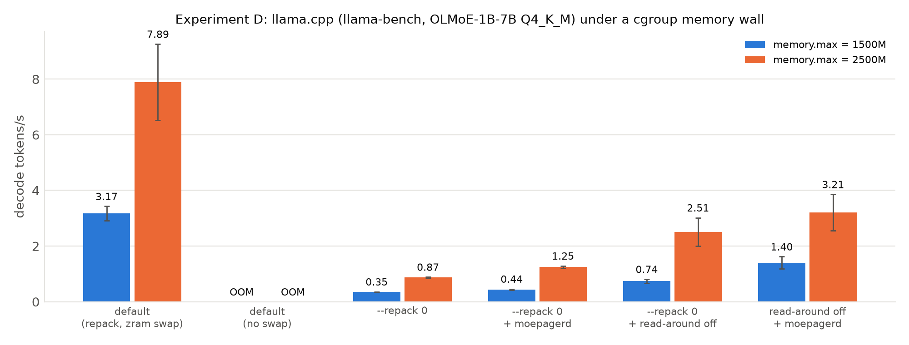

**Against the same engine serving weights from the page cache (B2):**
- PD is **4.0× faster at 1.5 GB** and **3.7× faster at 2.5 GB**.
- PD reads **8.4× and 7.0× fewer bytes from the SSD** per token.
- PD cuts memory-pressure stall (PSI) from 12.7 % to 1.0 % at 1.5 GB.
    This matters for other applications on the machine.

**Splitting the gain:**
- Turning read-around off accounts for 2.1–2.9×.
- moepagerd's completion readahead adds a further 1.9× (1.5 GB) and 1.3×
    (2.5 GB) on top.
- moepagerd *without* read-around off (D2) helps only 1.3–1.4×.

**Variability:** PD at 2.5 GB was measured in three independent sessions:
3.30 (1 repetition), 5.42 ± 1.07 and 3.21 ± 0.65 tok/s. The table reports
the last.

**Against default llama.cpp (B0):**
- B0 is faster (3.17 and 7.89 tok/s), but it gets there by pushing **2.5 GB
    and 2.3 GB of repacked weights into zram**, compressed swap that lives in
    RAM and is not counted against `memory.max` (journal: "1.4G memory peak,
    2.5G memory swap peak"). It therefore used far more than the budget.
- With swap disabled, so it is held to the same budget (B0S), default
    llama.cpp was **OOM-killed at both budgets**: it cannot run at all.
- moepager's configuration runs inside the budget.

A fair speed comparison against default llama.cpp therefore needs a
machine whose swap is on disk, or a budget that includes zram. That is
future work.

**Ablation (refractory window):** suppressing repeated completion requests
for 20 ms looked like an obvious efficiency fix, but it doubled misses and
cut PD at 2.5 GB from 3.21–5.42 to 1.09–2.05 tok/s. The repeats re-fetch
pages reclaimed while the engine is still working through an expert. The
window is therefore off by default.

## 6.6 Comparison with expected outcomes and with existing methods

| Expectation (IDEA_REVIEW, before measuring) | Outcome |
|---|---|
| Smarter eviction/pinning is the main lever (≥ 15 % fewer misses possible, K1) | The gap exists (Belady\* saves 34–74 % vs LRU), but our online V(e) policy did not capture it reliably, and pinning needs privileges. **Not the main lever.** |
| Bulk readahead beats fault-driven reads (K2) | Confirmed: ≈ 7× (Exp. C). |
| Default llama.cpp is beaten (K3) | Only at equal memory, where it OOMs. With zram it is faster. **Partially.** |
| (not anticipated) | Fault read-around pollution is the dominant cost: 3.7–4.8× read amplification. Turning it off is required for both correctness of black-box detection and speed. |

**Relation to existing methods:**
- Si et al. found that `fadvise` lookahead hints gain ≤ 5 % on a GH200
    with a `pread`-based engine. Our result differs because on an
    mmap-based engine the problem is *how* missing experts are read (small
    synchronous faults plus large wasted read-around), not *which* experts
    to keep. Completion readahead attacks exactly that.
- In-engine systems (MoE-Infinity, HOBBIT, llama.cpp PR #25294) see router
    decisions directly and can avoid the issue entirely. moepager reaches a
    3.7–4.0× improvement over the stock page-cache path without modifying
    the engine's code or binary, at the cost of one `LD_PRELOAD` hint.

## 6.7 Go / no-go decision

**GO, with narrowed scope** (recorded in PHASES.md):
- The product is "read-around off + expert-completion readahead",
    validated end to end.
- V(e) pinning and predictive prefetch are demoted to research options.
- The next phase must validate on a second machine with disk swap and
    ext4, and on a larger model.

# 7. Conclusion

## 7.1 Summary

We built moepager, a toolchain and daemon that manages the Linux page cache
for Mixture-of-Experts inference using the model file's structure, without
changing the inference engine's code.

The project was run as an experiment with kill criteria fixed in advance.
On a real model (OLMoE-1B-7B) on a 15 GB laptop, the outcome was:

- **Go on the mechanism, no-go on the original emphasis.** We expected
    smarter *eviction* to be the main lever. Measurement showed the dominant
    cost under memory pressure is the kernel's fault **read-around**. On this
    machine's btrfs it read 3.7× more data than needed and filled the cache
    with unused neighbouring experts.
- **What works:**
    - turning read-around off for the model mapping, with a 64-line
        `LD_PRELOAD` shim, since no stock llama.cpp option does this on
        single-node machines;
    - plus moepagerd's expert-completion readahead in 128 KiB chunks.

    Together they turn tens of thousands of 4 KiB faults per token into bulk
    reads. See Section 6.5 for the end-to-end numbers.
- **What doesn't (yet):**
    - Completion readahead *without* turning read-around off made things
        worse.
    - Our V(e) pinning policy did not beat simple LFU in simulation and
        needs extra privileges.
    - Default llama.cpp is faster than every page-cache configuration
        *if* it may spill 2.3–2.5 GB of repacked weights into zram (compressed
        RAM). Without swap it is OOM-killed at both budgets.
- **Smaller findings with independent value:**
    - The kernel silently truncates `WILLNEED`.
    - llama.cpp's default repacking moves 77–100 % of expert bytes out of
        the page cache.
    - llama.cpp's `--lazy-mode` keeps weights in anonymous memory.
    - btrfs reports different device numbers in `stat()` and
        `/proc/pid/maps`.

## 7.2 Limitations

- One machine, one filesystem (btrfs with a 4 MiB readahead window), one
    model (OLMoE). Qwen3-30B and gpt-oss-20b were mapped from their headers
    but not run, for lack of disk space and time.
- Short runs (32 decode tokens × 3 repetitions in llama-bench); some
    configurations show large run-to-run spread.
- A desktop session was running during measurements.
- Pinning (`mlock`), demotion (`MADV_COLD`) and eBPF observation are
    implemented but untested, because they need privileges.
- The shim is still an intervention in the engine's process, although it
    doesn't change its code or binary.

## 7.3 Future work

1. Upstream: propose a llama.cpp option to apply `MADV_RANDOM` to expert
      tensors on single-node machines, which would remove the need for the
      shim.
2. Repeat on ext4 (128 KiB readahead) and on the larger models, with
      longer runs.
3. Replace V(e) with an LFU-based residency policy (better in simulation)
      and evaluate pinning with `CAP_IPC_LOCK`.
4. Add a fallback when WILLNEED is ineffective (`MADV_POPULATE_READ`), and
      PSI-driven control of the memory budget to protect other applications.

# 8. References

1. A. Eliseev, D. Mazur. *Fast Inference of Mixture-of-Experts Language Models with Offloading.* arXiv:2312.17238, 2023.
2. L. Xue et al. *MoE-Infinity: Efficient MoE Inference on Personal Machines with Sparsity-Aware Expert Cache.* arXiv:2401.14361, 2024.
3. *HOBBIT: A Mixed Precision Expert Offloading System for Fast MoE Inference.* arXiv:2411.01433, 2024.
4. K. Alizadeh et al. *LLM in a flash: Efficient Large Language Model Inference with Limited Memory.* ACL 2024 (arXiv:2312.11514).
5. Y. Si, Y. Lin, D. Li, J. Zhang. *Who Should Own the Expert Cache? Kernel-Managed Tiering for Trillion-Parameter MoE Inference.* arXiv:2608.12103, 2026.
6. T. Zussman, I. Zarkadas, A. Cidon et al. *Cache is King: Smart Page Eviction with eBPF* (cachebpf / cache_ext). arXiv:2502.02750, 2025.
7. *DuoServe-MoE: Dual-Phase Expert Prefetch and Caching for LLM Inference QoS Assurance.* arXiv:2509.07379, 2025.
8. *A Survey on Inference Optimization Techniques for Mixture of Experts Models.* arXiv:2412.14219, 2024.
9. L. A. Belady. *A study of replacement algorithms for a virtual-storage computer.* IBM Systems Journal 5(2), 1966.
10. R. L. Mattson, J. Gecsei, D. R. Slutz, I. L. Traiger. *Evaluation techniques for storage hierarchies.* IBM Systems Journal 9(2), 1970.
11. llama.cpp (ggml-org): source at commit 970b51c (`src/llama-mmap.cpp`, `src/llama-model-loader.cpp`, `ggml/src/ggml-cpu/repack.cpp`); PRs #25294, #26824, #29887, #29250; issue #20757; discussion #27149. https://github.com/ggml-org/llama.cpp
12. Linux kernel: `mm/readahead.c` (`force_page_cache_ra`), `include/trace/events/filemap.h`; man pages `mincore(2)`, `posix_fadvise(2)`, `madvise(2)`, `process_madvise(2)`, `cachestat(2)`.
13. GGUF model files: allenai/OLMoE-1B-7B-0924-GGUF, unsloth/Qwen3-30B-A3B-GGUF, ggml-org/gpt-oss-20b-GGUF (Hugging Face).
